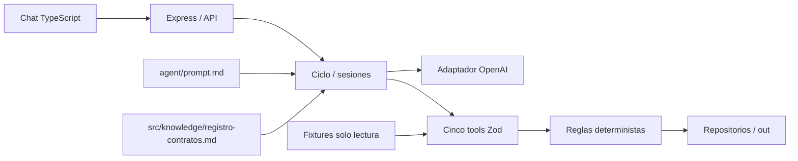

# Solución — Registro de Contratos Vigentes

Documento técnico parcial basado en la implementación local. No constituye aceptación ni release. Propuesta de gobierno contractual incorporada; integración real con OpenAI, costos observados y despliegue público pendientes.

## 1. Problema y afectados

Los contratos dispersos en correos impiden al analista mantener un maestro vigente y detectar vencimientos y pólizas pendientes; la aplicación organiza ese registro con evidencia y revisión humana.

## 2. Arquitectura

Un servicio Node24, TypeScript strict, Express5, Zod4 y Vite; sin BD ni framework de agentes. El entrypoint `src/tools/contratos.ts` es importable desde `demo.ts` sin HTTP o proveedor. Repositorios separan persistencia del dominio. CSV usa parser/stringifier; journal recuperable protege maestro, archivo, historial, recibo y auditoría.

## 3. Ciclo, límites y confirmación

El adaptador recibe mensajes y schemas Zod convertidos a JSON Schema. El loop ejecuta únicamente cinco nombres permitidos, enlaza resultados por callId y conserva historial. Límite25 rondas/120s por turno,30s por proveedor; resumen local ante fallo o límite. No hay reintentos de pago automáticos. La UI muestra herramientas, tabla por mensaje y revisión resaltada.

Las revisiones quedan en servidor, ligadas a sesión, candidato y revisión del maestro. El turno humano siguiente puede precisar y confirmar; datos incompletos siguen pendientes. `confirmado:true` enviado por el modelo no es autorización. El presenter obtiene hechos exclusivamente de herramientas; descarta las afirmaciones libres no respaldadas. Sesiones en memoria; maestro y presupuesto durables.

## 4. Modelo y costo

Adaptador nativo fetch Chat Completions de OpenAI; modelo configurable, default del Plan `gpt-5.4-mini-2026-03-17`. La elección busca llamadas de herramientas con costo acotado y sin SDK/framework adicional. **Disponibilidad y comportamiento reales no verificados**. Las pruebas usan un adaptador controlado y no consumen tokens facturables.

Costo por interacción = suma de entrada de **todas** las rondas × tarifa entrada + suma de salida × tarifa salida, dividido por millón; costo por contrato = costo de interacción / contratos realmente procesados. El ejemplo del Plan (20000 entrada,4000 salida,USD0.033 por lote) es orientativo, no medición. Tarifas deben revalidarse oficialmente antes del live check; costo real por caso pendiente. El ledger reserva bytes UTF-8+8192+tope salida como sobre conservador, no conteo exacto; reconcilia usage real, conserva reserva desconocida y bloquea si se excede.

## 5. Extracción y confianza

Patrones de cláusulas identifican contraparte, número/NIT, objeto, valor/moneda, plazo y garantías; separan Periferia de su cliente. Normalización soporta formatos monetarios y fechas españolas presentes en fixtures. Evidencia y origen acompañan cada campo. Confianza técnica: explícitos0.95, normalizados0.9, derivados/demanda0.75, propuestas0.5, ausencia null/0. No son probabilidades calibradas. Todo valor inferior a0.8 se revisa.

Otrosí hereda campos no modificados del maestro con procedencia; otrosí explícito precede reglas de duplicado, y RN1 precede RN2 en documento ordinario. El modelo orquesta; no decide integridad, coincidencia, autorización o escritura. Heurísticas cubren el ejercicio TXT, no prometen extracción universal ni OCR.

## 6. Propuesta de regla de gobierno contractual

### Modelo de gobierno objetivo — Periferia

**Objetivo:** Garantizar que el 100 % de los contratos formalizados, con o sin póliza, sean recibidos, evaluados y registrados oportunamente mediante un proceso centralizado, automatizado y trazable.

### 6.1. Modelo operativo y responsabilidades

Se establece **`contratos@periferia.example`** como canal único obligatorio para la recepción de contratos, otrosíes y actas de terminación.

Un agente automatizado ejecutará la recepción y clasificación documental, extracción y validación de datos, identificación de duplicados y actualizaciones, registro en el maestro, archivo contractual y generación de alertas. Los casos que requieran confirmación o criterio humano serán derivados a Administración Contractual.

**Administración Contractual será la propietaria del proceso**, responsable de su operación, integridad del maestro, gestión de excepciones y reporte mensual a Gerencia. Comercial responde por la entrega documental y Liderazgo Comercial por los incumplimientos de su equipo.

*Detalle de responsabilidades: Anexo A.*

### 6.2. Política de entrega y registro

Todo comercial deberá enviar el contrato firmado en PDF, sus otrosíes, actas de terminación y anexos pertinentes **dentro de los dos días hábiles posteriores a su firma o modificación**, independientemente de que requiera póliza.

**Asunto obligatorio:** `CONTRATO | Cliente | ID | ALTA / OTROSI / TERMINACION`

No se aceptarán canales alternativos. Administración deberá asegurar el registro dentro de los **dos días hábiles siguientes a la recepción de documentación completa y validada**.

### 6.3. Confirmación, excepciones y escalamiento

El agente emitirá un **acuse de recepción en un máximo de cinco minutos**. Este acuse no equivale a aceptación ni a registro exitoso. Cada documento contará con un estado trazable y se notificará cuando el registro haya concluido.

Los documentos incompletos, campos de baja confianza, pólizas pendientes y demás excepciones tendrán un responsable y plazo de resolución. No se incorporarán datos no verificados al maestro.

Las excepciones vencidas se escalarán al liderazgo comercial o responsable funcional; si continúan sin resolverse durante cinco días hábiles, se elevarán a Gerencia.

*Estados, tratamiento de excepciones y plazos: Anexo B.*

### 6.4. Recuperación de contratos: junio–agosto de 2026

Se ejecutará una campaña extraordinaria de **20 días hábiles desde su aprobación**, con cinco fases: inventario (día 3), recolección (día 8), conciliación (día 13), subsanación (día 17) y cierre ejecutivo (día 20).

Los contratos no regularizados permanecerán abiertos en un registro de excepciones, con responsable, causa y fecha compromiso. Serán escalados a Gerencia y afectarán los indicadores del área responsable hasta su resolución.

*Cronograma, responsables y entregables: Anexo C.*

### 6.5. Indicadores y rendición de cuentas

El cumplimiento será evaluado mensualmente y formará parte de los objetivos anuales de desempeño:

| Indicador | Meta propuesta |
| --- | ---: |
| Contratos facturados registrados en el maestro | ≥ 98 % |
| Documentación entregada dentro del plazo | ≥ 95 % |
| Contratos registrados dentro del SLA administrativo | ≥ 95 % |
| Excepciones resueltas dentro del SLA | ≥ 95 % |
| Registros completos y trazables | ≥ 99 % |

Comercial responde por la entrega; Administración, por el registro y seguimiento; y Gerencia, por el cumplimiento global. Los incumplimientos recurrentes darán lugar a planes de mejora conforme a las políticas de desempeño.

*Definiciones, fórmulas y responsables de los indicadores: Anexo D.*

**Principio de gobierno:** Ningún contrato debe quedar fuera del control institucional por depender de una persona, un correo individual o la necesidad de una póliza.

## 7. Decisiones y trade-offs

| Decisión | Alternativa descartada | Consecuencia |
| --- | --- | --- |
| Monolito modular Node | Microservicios/BD | Menor operación; un escritor/una instancia |
| Extracción determinista con evidencia | LLM como validador único | Verificación sin clave; cobertura lingüística acotada |
| CSV y journal recuperable | Escrituras independientes | Más lógica local; recuperación coherente ante fallo parcial |
| Sesiones en memoria | Persistencia de chat | Simplicidad; historial conversacional se pierde en restart |
| Presentación de hechos desde tools | Texto libre contractual | Evita valores inventados; menor flexibilidad narrativa |
| Vite8/Vitest5/csv-parse7 fijados | Versiones iniciales con avisos de seguridad | Lock actualizado; audit local sin vulnerabilidades en la última instalación |

## 8. Supuestos y Clarify

Q1: agosto2026 en msg-006 no autoriza inventar día; fecha exacta obligatoria para registrar. Se conserva conflicto con ejemplo abreviado §11. Q2: cláusula condicional de póliza requiere decisión humana; no aplicar true/false automáticamente. Q3: otrosí primero; duplicado ordinario RN1 antes de RN2. Q4: duplicado/rechazo cierran procesamiento con log sin cambios contractuales; errores recuperables siguen abiertos. Q5: alta usa reloj de ejecución, actualización conserva fecha anterior; alertas0..60 inclusive y corte2026-05-30. Datos de prueba humanos están etiquetados en `tests/support/human-inputs.ts`; no son verdades extraídas ni defaults del producto.

## 9. Cobertura

| HU | Estado local | Evidencia / pendiente |
| --- | --- | --- |
| HU-1 Buzón | Hecho | Contratos y pruebas de correo; seis fixtures |
| HU-2 Extracción | Hecho para TXT del ejercicio | Unit/contract; calibración en datos reales pendiente |
| HU-3 Clasificación | Hecho | Reglas deterministas y precedencia; prueba de duplicados/otrosí |
| HU-4 Registro | Hecho local | Confirmación, journal, recibos, navegador; verificación servidor público pendiente |
| HU-5 Alertas | Hecho local | Límites temporales y reporte; despliegue pendiente |
| HU-6 Errores | Parcial hasta live | Tests controlados de herramientas/provider/límites; proveedor real pendiente |

Demo verifica once filas únicas, cuatro eventos contractuales y seis procesados con entradas humanas declaradas. P1 PDF, streaming y bonus no implementados. No se creó `modulo/`. Toda aceptación final depende además de documentación completa, URL, modelo real y aprobación.

## 10. Uso de IA

Codex asistió en lectura de artefactos, diseño conforme Plan, código, pruebas y documentación. Se evitó completar fechas a partir de meses y se descartó confiar en booleanos o evidencia humana fabricados por el modelo, porque violan Clarify/autorización. Las respuestas simuladas prueban la orquestación; no se presentan como resultados de OpenAI real. El responsable aún debe revisar y aprobar cambios significativos.

## 11. Riesgos y mitigaciones

Heurísticas no calibradas: revisión humana y pruebas con documentos adicionales antes de producción. Fallos de disco/OneDrive: journal, backups completos y proceso único; no garantía de atomicidad para lectores externos. Sesiones perdidas: UI informa y permite iniciar otra, preservando contratos/cuotas. Enlace público sin login: cuota global durable, sin herramientas arbitrarias; protección adicional fuera de P0. Dependencia del proveedor: timeouts, sin retries, trabajo previo conservado. Tarifas/modelo/hosting: comprobación real acotada antes de release. Gobierno contractual: propuesta documentada; su aprobación y adopción organizacional siguen pendientes. Ver README para recuperación; pruebas reales de restart/restauración pública siguen pendientes.

---

## Anexo A. Matriz de roles y responsabilidades

| Involucrado | Responsabilidad | Rendición de cuentas |
| --- | --- | --- |
| **Área Comercial** | Remitir contratos firmados, otrosíes y terminaciones; subsanar documentación incompleta | Cumplimiento de plazos y calidad de entrega |
| **Administración Contractual** | Supervisar el agente, validar excepciones, mantener el maestro y gestionar pólizas | Integridad, trazabilidad, registro oportuno y actualización del maestro |
| **Liderazgo Comercial** | Gestionar incumplimientos, exigir regularizaciones y escalar retrasos | Cumplimiento de los indicadores de su equipo |
| **TI / Soporte del Agente** | Mantener disponibilidad, seguridad, integraciones y trazabilidad técnica; resolver fallas operativas | Continuidad operativa |
| **Gerencia** | Revisar indicadores, riesgos y excepciones vencidas; aprobar acciones correctivas | Supervisión del proceso |
| **Responsable jurídico designado** | Resolver consultas contractuales que excedan la validación administrativa | Criterio jurídico cuando sea requerido |

El agente no sustituye la revisión jurídica. Administración conserva la responsabilidad sobre las confirmaciones humanas y las decisiones de registro que requieran validación.

## Anexo B. Estados, excepciones y escalamiento

### B.1. Estados de procesamiento

| Estado | Significado |
| --- | --- |
| **Recibido** | Documento ingresado al canal oficial |
| **En validación** | Información en proceso de extracción y verificación |
| **Pendiente de subsanación** | Se requiere documentación, corrección o confirmación humana |
| **Registrado** | Contrato validado e incorporado al maestro |
| **Duplicado** | Documento previamente registrado, sin cambios aplicables |
| **Rechazado** | Documento que no corresponde a un contrato o no cumple los criterios mínimos de identificación |

El acuse automático incluirá el identificador, los documentos recibidos y el estado inicial. El registro exitoso se notificará una vez completadas las validaciones.

### B.2. Matriz de resolución

Las excepciones se gestionarán mediante un registro administrativo con responsable, motivo, fecha de identificación y estado de resolución.

| Situación | Responsable y acción requerida | Plazo |
| --- | --- | --- |
| Documento incompleto, sin firma o sin información esencial | **Comercial:** subsanar. **Administración:** solicitar y verificar la corrección | 1 día hábil para solicitar; 2 para subsanar |
| Campo de baja confianza | **Administración:** verificar y confirmar o solicitar aclaración a Comercial | Antes del registro |
| Documento rechazado por no ser contractual | **Administración:** informar el motivo. **Comercial:** remitir documento correcto, si corresponde | 2 días hábiles |
| Duplicado | **Administración:** verificar cuando sea necesario y cerrar sin modificar el maestro | Durante el procesamiento |
| Póliza pendiente | **Administración:** coordinar con Comercial y el corredor correspondiente | Según vencimiento y criticidad |
| Error técnico del agente | **TI:** investigar, corregir y comunicar la recuperación | Según criticidad operativa |
| Duda de interpretación contractual | **Responsable jurídico designado:** emitir criterio | Según complejidad y criticidad |

### B.3. Escalamiento

Si una excepción no se resuelve dentro del plazo establecido, Administración la escalará al liderazgo comercial o responsable funcional correspondiente. Si permanece sin resolver durante cinco días hábiles, se elevará a Gerencia como incumplimiento abierto.

Los contratos no regularizados permanecerán identificados como pendientes o excepciones, sin inventar datos ni incorporarlos incorrectamente al maestro.

## Anexo C. Campaña extraordinaria de regularización

**Alcance:** Contratos firmados, modificados o terminados entre el 1 de junio y el 31 de agosto de 2026.

**Duración:** 20 días hábiles a partir de la aprobación de la campaña.

| Fase | Fecha límite | Responsable | Entregable |
| --- | --- | --- | --- |
| **1. Lanzamiento e inventario** | Día hábil 3 | Liderazgo Comercial | Listado de contratos firmados, modificados o terminados en el período |
| **2. Recolección documental** | Día hábil 8 | Comerciales | Documentación remitida al canal único |
| **3. Conciliación y validación** | Día hábil 13 | Administración | Contratos válidos, duplicados, actualizaciones y excepciones identificadas |
| **4. Corrección de pendientes** | Día hábil 17 | Comerciales y líderes | Documentación subsanada y campos confirmados |
| **5. Cierre y reporte ejecutivo** | Día hábil 20 | Administración y Gerencia | Informe de regularización, brechas, responsables y acciones correctivas |

**Tratamiento de pendientes:** Todo contrato no regularizado al cierre permanecerá en el registro de excepciones con responsable asignado, causa del incumplimiento y fecha compromiso.

Los casos vencidos serán escalados a Gerencia y al liderazgo comercial correspondiente, permanecerán abiertos hasta su regularización y afectarán los indicadores de cumplimiento del área responsable.

Ningún contrato podrá declararse regularizado sin documentación suficiente y validación administrativa.

## Anexo D. Indicadores y evaluación de desempeño

Los indicadores se medirán mensualmente y se incorporarán a los objetivos anuales de las áreas involucradas.

| Indicador / Fórmula | Responsable evaluado | Meta anual propuesta |
| --- | --- | --- |
| Contratos facturados con registro en el maestro / Total de contratos facturados | Indicador global: Administración y Liderazgo Comercial | ≥ 98 % |
| Documentos remitidos dentro del plazo / Total de documentos obligatorios | Área Comercial | ≥ 95 % |
| Contratos registrados dentro de dos días hábiles desde la recepción completa / Total de contratos aptos para registro | Administración | ≥ 95 % |
| Excepciones resueltas dentro del SLA / Total de excepciones cerradas | Administración y responsable funcional de resolución | ≥ 95 % |
| Contratos con datos completos y trazables / Total de contratos registrados | Administración | ≥ 99 % |

**Responsabilidad sobre resultados:** Comercial responde por la entrega completa y oportuna; Administración, por la validación, el registro oportuno y el seguimiento de excepciones; Gerencia supervisa el cumplimiento global.

Los incumplimientos recurrentes deberán incorporarse a planes de mejora del área responsable. Su impacto en la evaluación anual se regirá por las políticas de desempeño aprobadas por la organización.
