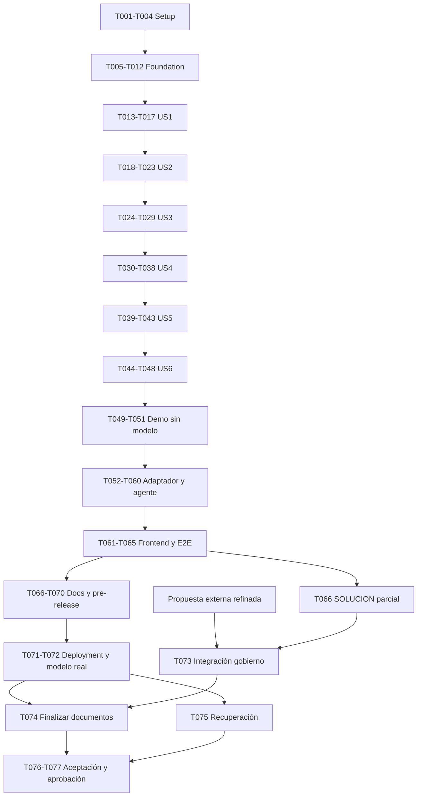

# Tasks: Registro de Contratos Vigentes

**Input**: [spec.md](spec.md), Q1–Q5, [plan.md](plan.md), [research.md](research.md), [data-model.md](data-model.md), [contracts/interfaces.md](contracts/interfaces.md), [quickstart.md](quickstart.md), PRD §§0–11 y Constitución v2.0.0.
**Created**: 2026-10-22. Una feature consolidada, rama actual main. Este archivo define trabajo futuro; ninguna casilla representa trabajo ya implementado.
**Tests**: Obligatorios por solicitud, spec y Constitución V; el texto genérico de plantilla que dice opcionales no aplica. Escribir primero pruebas de comportamiento y comprobar que fallan por el comportamiento ausente, no por errores de harness; implementar y hacerlas pasar antes del checkpoint.
**Organization**: US1–US6 equivalen HU-1–HU-6, todas P0. Dependencias por tarea entre paréntesis; las fases bloquean a las siguientes salvo paralelismo indicado. `[P]` permite trabajo simultáneo en archivos distintos solo tras satisfacer dependencias; no autoriza agentes adicionales ni ediciones simultáneas de src/tools/contratos.ts.
**Paths**: Relativos a raíz del repositorio. Out es generado, fixtures son inmutables; tests usan copias temporales. Las modificaciones a contratos o garantías se revisan conforme Constitución, sin ampliar alcance ni inventar reglas.
**Gobierno contractual**: La propuesta de una página se está refinando fuera de este workflow. T073 integra el contenido final proporcionado por su responsable; no inventar ni finalizar responsables, plazos, acuses, escalamiento o indicador. No es opcional: bloquea la finalización documental y aceptación, no el resto de implementación.

## Phase 1: Setup — proyecto reproducible

**Goal**: Toolchain Node24/TypeScript, pruebas controladas y comandos declarados.

- [X] T001 Crear package.json y package-lock.json con Node24/ESM, Express5, Zod4, csv-parse/csv-stringify y las dependencias de desarrollo elegidas en research R1–R2; fijar versiones compatibles y justificar sin añadir framework de agentes/BD (NFR-001/003/005).
- [X] T002 Configurar tsconfig.json y tsconfig.build.json strict, sin any explícito ni implícito en aplicación; incluir chequeo que detecte any explícito en scripts/check-types.ts y package.json, sin excluir frontend ni tests del chequeo (depende T001; PRD §8).
- [X] T003 [P] Configurar Vitest y Playwright en vitest.config.ts y playwright.config.ts, separando suite sin red, navegador con fake y live opt-in; agregar scripts test/test:e2e en package.json antes de ejecutar fases posteriores (depende T002; Constitución V).
- [X] T004 Configurar .gitignore, src/config.ts y .env.example: excluir .env, out/, node_modules/, dist/ y evidencias sensibles; validar PORT, modelo, iteraciones25, output2048, tokens sesión1000000/global2000000, timeouts30000/120000 y zona America/Bogota según Plan; permitir demo sin clave, no límites desactivados; defaults no secretos documentables (depende T003; NFR-003/004/006).

## Phase 2: Foundational — modelos y fronteras compartidos

**Goal**: Contratos tipados, persistencia aislada y ejecución directa importable sin HTTP/LLM. No iniciar historias antes de este checkpoint.

- [X] T005 Crear esquemas de entrada/extracción en src/domain/schemas.ts: correo con id/de/para/asunto/fecha ISO con offset/cuerpo/adjuntos relativos, catálogo `{email,nombre,region}[]`, extracción con campos anulables, `confianza:Record<campo,number>` en [0,1], evidencia `{texto,origen}` y origen documento/derivación/maestro/catálogo/humano/sistema; ausencia `null` con confianza `0`, valor_indeterminado y es_otrosi booleanos, condición de póliza separada; sin columnas CSV nuevas (depende T004; FR-003/019/020).
- [X] T006 Completar esquema maestro y resultados en src/domain/schemas.ts y tests/unit/schemas.test.ts: conservar orden de los 17 encabezados del fixture; id string/AUTO, cliente string, nit string sin perder ceros, pais `CO/EC/PE/PA/HN`, objeto `String ≤200 caracteres`, valor `Número finito sin separadores`, moneda `COP/USD/PEN/PAB/HNL`, fechas `Fecha calendario real YYYY-MM-DD` y fin no anterior al inicio, requiere_poliza boolean, tipo `String con lista ;`/vacío si no requiere, estado `vigente/pendiente/vencida/no_aplica`, comercial string/vacío con advertencia, ruta relativa, fecha_registro fecha y fuente `buzon/manual/migracion`; probar null permitido solo en extracción, no en fila requerida (depende T005; PRD §7.2).
- [X] T007 [P] Definir puertos concretos y Clock inyectable en src/application/ports.ts y src/infrastructure/clock.ts para mailbox, contratos, auditoría, presupuesto y confirmación; fecha de ejecución controlable y aritmética fecha-sola UTC; ctx público sigue `{directory:string,sessionId:string}` (depende T006; Constitución I–II, Q5).
- [X] T008 [P] Implementar confinamiento y validación de rutas en src/infrastructure/paths.ts y tests/unit/paths.test.ts: raíz fijada en bootstrap, solo adjuntos enumerados, realpath de padres, rechazar traversal/absolutas/symlinks externos; sin shell ni paths elegidos por HTTP/LLM (depende T006; NFR-004).
- [X] T009 [P] Implementar auditoría segura en src/infrastructure/audit.ts y tests/unit/audit.test.ts: `{ts,herramienta,mensaje_id,ok,resumen}` con mensaje_id null agregado, correlationId/callId y referencias de estado, redacción de secretos/datos sensibles sin documentos completos; error de logging no permite anunciar éxito contractual sin evidencia (depende T006; FR-013, RN7, Constitución VI).
- [X] T010 Implementar base FileContractRepository en src/infrastructure/contracts-repository.ts: CSV con parser/stringifier, copia semilla solo si ausente, ocho filas iniciales verificadas, snapshots coherentes y cierre operativo procesados/log; interfaces preparadas para commit/recovery T033, sin escritura contractual no recuperable; no reseed sobre estado existente (depende T007–T009; RN6, Q4).
- [X] T011 Crear runtime y envoltorio común en src/application/runtime.ts y src/tools/contratos.ts: description de una frase, args como objetos Zod con describe por campo, execute async retorna string JSON ok/data o ok:false/error legible y nunca propaga excepción; validación también en ejecución directa, sin importar servidor/proveedor ni side effects de arranque; exports se incorporan por historia (depende T010; FR-016, PRD §6.2).
- [X] T012 Crear harness aislado en tests/support/workspace.ts y tests/support/fakes.ts con copias temporales, hashes de fixtures, reloj2026-09-03, fallos inyectables y runtime confiable de demo distinto del conversacional; comprobar aislamiento/sin acceso a red en tests/integration/foundation.test.ts (depende T011; Constitución II–V).

**Checkpoint**: Schemas, reloj, auditoría, rutas y contratos base verificables; ningún requisito exige autenticación, BD ni infraestructura externa.

## Phase 3: User Story 1 — Leer el buzón (P0)

**Goal**: Mostrar pendientes y rechazos sin ocultar msg-005 antes de informarlo.
**Independent Test**: Con seis correos iniciales, comparar metadatos y repetir consulta tras cierre Q4, sin modelo.

- [X] T013 [P] [US1] Escribir tests/contract/leer-buzon.test.ts para export contratos_leer_buzon, args `{}`, ctx y JSON string; éxito con todos los campos HU-1, argumentos extra rechazados y errores sin throw (depende T012; FR-002/016).
- [X] T014 [P] [US1] Escribir tests/integration/mailbox.test.ts para seis mensajes, adjuntos reales otrosi.txt/cotizacion.txt, pendientes excluidos por procesados y msg-005 rechazado con motivo mostrado antes del cierre; comprobar solo procesados/log cambian por rechazo (depende T012; RN4, Q4).
- [X] T015 [US1] Implementar listado/lectura y detección contractual por contenido en src/infrastructure/mailbox-repository.ts y src/domain/document-kind.ts; validar correo/adjuntos y reconocer cotización sin convertir su importe en contrato (depende T013–T014).
- [X] T016 [US1] Implementar src/application/leer-buzon.ts y export leer_buzon en src/tools/contratos.ts: snapshot de pendientes inicial, reporte del rechazo antes de cierre y próxima lista lo excluye, log por ejecución; sin efectos contractuales (depende T015; FR-002/021).
- [X] T017 [US1] Ejecutar suites US1, verificar hashes de fixtures y registrar evidencia/resultado del checkpoint en tests/evidence/US1.md sin secretos ni out versionado (depende T016).

## Phase 4: User Story 2 — Extraer con confianza (P0)

**Goal**: Datos deterministas y evidencia, nunca completar fechas o pólizas inciertas.
**Independent Test**: Extraer cinco documentos contractuales y rechazar cotización/entradas erróneas usando solo textos/Clock.

- [X] T018 [P] [US2] Escribir tests/contract/extraer.test.ts para `{mensaje_id}`, Contrato con confianza por campo [0,1], JSON serializado y error legible no throw ante texto vacío (depende T017; FR-003/016).
- [X] T019 [P] [US2] Escribir tests/unit/extraction.test.ts para contraparte vs Periferia, importes COP/USD/PEN y separadores, fechas españolas explícitas, plazo derivado, objeto≤200, NIT/RUC/RTN sin perder ceros, ausencia null/0 y msg-006 inicio/póliza/moneda pendientes según Q1–Q2 (depende T017).
- [X] T020 [US2] Implementar parsers en src/domain/parsers.ts con meses/números entre paréntesis, normalización decimal finita y calendario estricto, DV explícito CO sin recortar RUC/RTN; error para fecha/moneda inválida, no confundir umbral de garantía con importe del marco (depende T018–T019).
- [X] T021 [US2] Implementar extractor y evidencia en src/domain/extract.ts: cláusulas genéricas, sin hardcodear IDs; escala research R4 `0.95/0.90/0/0.75/0.50`, valor por demanda0 con revisión, no presentar campos de sistema/catálogo como extraídos, no inferir día de agosto ni aplicabilidad de garantía condicional (depende T020).
- [X] T022 [US2] Implementar src/application/extraer.ts y export extraer en src/tools/contratos.ts con selección de adjunto validada, auditoría y schemas; verificar herramienta directa sin import proveedor/HTTP (depende T021; FR-003/019/020).
- [X] T023 [US2] Ejecutar suites de extracción/contrato e imprimir/verificar valores265000000COP,120000USD,520000PEN y evidencia de msg-006; registrar discrepancia §11 y resultados en tests/evidence/US2.md sin inventar datos faltantes (depende T022).

## Phase 5: User Story 3 — Validar y clasificar (P0)

**Goal**: Preservar clasificaciones PRD y reglas RN1–RN5 con revisión explícita.
**Independent Test**: Validar los seis casos contra snapshot inicial, sin chat ni escritura contractual.

- [X] T024 [P] [US3] Escribir tests/contract/validar.test.ts para `{mensaje_id,contrato}`, clasificación, id existente/diferencias opcionales y requiere_revision[]; probar confianza inferior0.8 vs exactamente0.8 y datos no confiables (depende T023; FR-004/005/016).
- [X] T025 [P] [US3] Escribir tests/unit/classification.test.ts para Q3 (otrosí primero, ordinarios RN1 antes RN2), msg-004 duplicado aunque objeto difiera, mismo NIT/objeto similitud≥0.9 inclusive, múltiples candidatos en revisión, desconocido no bloqueante y otrosí parcial sin borrado (depende T023).
- [X] T026 [US3] Implementar identidad/similitud en src/domain/classify.ts y src/domain/similarity.ts usando normalización NFKD/acentos/minúsculas/puntuación/espacios y Levenshtein normalizado research R4; aplicar RN4 y Q3/RN1–RN3, no deduplicar solo por nombre del cliente (depende T024–T025).
- [X] T027 [US3] Implementar validación/revisión en src/domain/validate.ts: invariantes/umbral<0.8/conflictos, herencia maestro explícita para otrosí, catálogo por email y comercial vacío con advertencia si desconocido; no elevar confianza ni aceptar evidencia humana inventada del modelo (depende T026; RN5, FR-019/020).
- [X] T028 [US3] Implementar src/application/validar.ts y export validar en src/tools/contratos.ts: diferencias/candidato/revisión del maestro, cierre Q4 de duplicado/rechazado y log sin maestro/archivo/historial, mantener pendientes y errores abiertos (depende T027; FR-021).
- [X] T029 [US3] Ejecutar suites US3 y comprobar clasificaciones nuevo/nuevo/actualizacion/duplicado/rechazado/nuevo-revisión; guardar matriz de resultados en tests/evidence/US3.md (depende T028).

## Phase 6: User Story 4 — Registrar y archivar (P0)

**Goal**: Escribir solo candidatos completos autorizados, con recuperación y sin duplicados.
**Independent Test**: Invocar registrar directamente sobre copias; confirmar revisión explícitamente y verificar fila/archivo/historial/procesados; simular cada fallo de publicación.

- [X] T030 [P] [US4] Escribir tests/contract/registrar.test.ts: `{mensaje_id,contrato,confirmado?:boolean}`→id/accion/ruta o error `requiere revisión: ...`, sin throw; revisión sin confirmado no escribe, confirmado no admite null requerido/fecha inválida (depende T029; HU-4).
- [X] T031 [P] [US4] Escribir tests/integration/recovery.test.ts para fallos en cada publicación/marker, rollback/restart/recovery bloqueante, receipt tras respuesta perdida y reintento de otrosí sin segunda fila/línea; lectores de aplicación no observan parcial (depende T029; Constitución III).
- [X] T032 [P] [US4] Escribir tests/unit/confirmation.test.ts para siguiente turno humano, hash/sesión/revisión, datos parciales Q1–Q2 y boolean del modelo insuficiente; reservar tests de runtime conversacional para T055 (depende T029; FR-012/019/020).
- [X] T033 [US4] Implementar mutex/lock de único proceso, staging/journal/marker/rollback y recovery en src/infrastructure/transaction.ts y src/infrastructure/contracts-repository.ts según data-model; snapshots de archivo/historial/procesados y receipt/hash, recuperación antes de servir; fallos irrecuperables bloquean estado, nunca reseed destructivo (depende T030–T032).
- [X] T034 [US4] Implementar archivado/historial/id AUTO en src/infrastructure/archive.ts y src/application/register-contract.ts: ruta `out/sharepoint/Contratos/<año_inicio>/<cliente-slug>/<id_contrato>.<ext>`, TXT exacto/hash igual, ruta relativa, historial `{ts,id_contrato,accion,cambios,mensaje_id}`, secuencia anual bajo lock y receipt; actualizar fila conserva fecha_registro/otros datos no cambiados; logs coordinados con commit (depende T033; RN6/RN7, Q5).
- [X] T035 [US4] Implementar política de revisión/confirmación en src/application/confirmation.ts y src/application/runtime.ts: pendiente ligado a candidato/hash/sesión/maestro y siguiente humano, correcciones validadas/procedencia preservada; modo directo confiable solo bootstrap demo, imposible seleccionarlo desde HTTP/LLM (depende T034; CA3, Q1–Q2).
- [X] T036 [US4] Completar src/application/registrar.ts y export registrar en src/tools/contratos.ts: revalidar bajo lock, impedir confianza manipulada/autorización falsa, devolver receipt en reintento; duplicado/rechazado no son altas/actualizaciones ni archivan; no cerrar errores/revisión (depende T035; FR-006/021).
- [X] T037 [US4] Crear entradas humanas declaradas en tests/support/human-inputs.ts para probar distintas fechas precisas y ambos ramos de póliza/moneda de msg-006, sin modificar fixture ni declararlas verdad contractual; probar valor0/fin2027-08-31 insuficientes y otrosí conserva datos/origen en tests/integration/registration.test.ts (depende T036; Q1–Q5).
- [X] T038 [US4] Ejecutar contratos, integración y recuperación; verificar CT-2026-011 valor520000PEN/fin2027-11-01, receipt/historial único, datos fiscales intactos y hashes fixture; registrar evidencia en tests/evidence/US4.md (depende T037).

## Phase 7: User Story 5 — Alertar (P0)

**Goal**: Reporte determinista de tres secciones sin alterar contratos.
**Independent Test**: Alertas con hoy2026-09-03, reloj controlado y maestro conocido; probar límites y altas vs actualizaciones.

- [X] T039 [P] [US5] Escribir tests/contract/alertas.test.ts para `{hoy:YYYY-MM-DD}`, ruta/vencen/polizas_pendientes/registrados_desde_corte y fecha inválida sin throw (depende T038; FR-007/016).
- [X] T040 [P] [US5] Escribir tests/unit/alerts.test.ts: `0 ≤ fecha_fin - hoy ≤ 60` calendario inclusivo, pasado/día61 fuera, `requiere_poliza && estado_poliza!=vigente`, corte `fecha_registro>=2026-05-30`, actualización conserva fecha original y póliza Q2 no se presume (depende T038; FR-022).
- [X] T041 [US5] Implementar filtros/orden estable y renderer Markdown en src/domain/alerts.ts y src/domain/dates.ts; usar hoy explícito, no fecha del equipo ni reiniciar fecha de alta (depende T039–T040).
- [X] T042 [US5] Implementar src/application/alertas.ts y export alertas en src/tools/contratos.ts, publicación coherente de out/alertas.md con tres secciones, arrays estructurados y auditoría; sin escritura de maestro/procesados/historial (depende T041).
- [X] T043 [US5] Ejecutar suites y comprobar vencen CT-2026-004/009, pendientes004/015 tras alta limpia, nuevas015/016 y CM-2026-03 solo tras confirmar; 011 actualizado no entra por fecha; registrar en tests/evidence/US5.md (depende T042).

## Phase 8: User Story 6 — Continuidad y errores (P0)

**Goal**: Aislar mensajes defectuosos y conservar sesión/estado útil.
**Independent Test**: Lote con texto vacío, fecha inválida, moneda desconocida seguido de válido; provider controlado con fallo/timeout y cuota agotada.

- [X] T044 [P] [US6] Escribir tests/integration/tool-errors.test.ts para entradas HU-6, Zod inválido y fallos fs; cinco herramientas devuelven JSON ok:false/error legible sin lanzar; caso siguiente sigue y mensaje fallido no se cierra (depende T043; FR-008).
- [X] T045 [P] [US6] Escribir tests/unit/config-budget.test.ts con límites/valores inválidos, reserva concurrente, nuevas sesiones/reinicio no evaden ledger, timeout conserva reserva y exceso de envelope detiene nuevas llamadas (depende T043; FR-010, NFR-006).
- [X] T046 [US6] Completar clasificación de errores/redacción y procesamiento de lote en src/application/errors.ts y src/application/process-mailbox.ts; conservar resultados previos/pendientes y continuar siguiente mensaje sin ocultar fallos del estado consistente (depende T044–T045; HU-6, Constitución III/VI).
- [X] T047 [US6] Implementar ledger durable/mutex y presupuesto en src/infrastructure/budget.ts: límites/bytes+8192+output y máximo60 mensajes/5tools del Plan, reservar antes de fetch, usage reconciliado/timeout conservador, sin reset remoto; API de abort/deadline para loop posterior (depende T046; NFR-006).
- [X] T048 [US6] Ejecutar suites US6 y contratos de cinco tools; registrar evidencia en tests/evidence/US6.md y dejar identificadas verificaciones provider/sesión dependientes de T052–T060, sin declarar conversación completa antes de ese gate (depende T047).

## Phase 9: Polish & Cross-Cutting — demo, agente, frontend y entrega completa

Esta fase contiene integración obligatoria, no mejoras prescindibles. No se da por terminada la feature con solo US1 o herramientas. Cada bloque tiene un checkpoint; completar el bloque determinista antes de conectar LLM.

### Demo y gate determinista temprano

- [X] T049 Implementar demo.ts y script demo en package.json: limpiar solo out local validado sin escritor, reloj2026-09-03, procesar seis mensajes en orden con cinco tools, imprimir clasificación/revisión/acción; primera pasada no registra pendientes, segunda llamada con confirmado:true y datos humanos declarados de T037 para caso pendiente, completar revisión de otrosí; exit no cero ante verificación fallida, sin clave/import provider (depende T048; FR-017).
- [X] T050 Escribir y ejecutar tests/integration/demo.test.ts invocando demo dos veces sin OPENAI_API_KEY, comparar resultados/archivos salvo timestamps/correlación técnica, verificar diez filas tras dos altas y once al completar tres altas/actualización, cuatro líneas contractuales finales y seis procesados; original de fixtures idéntico (depende T049; SC-001–007).
- [X] T051 Ejecutar typecheck, suite completa sin red y demo; registrar gate determinista en tests/evidence/deterministic.md con fuente/resultados y cobertura HU1–HU6/RN1–RN7; corregir fallos antes de T052, no sustituir demo por tests (depende T050).

### Adaptador y conversación real

- [X] T052 Crear src/llm/adapter.ts y tests/support/llm-adapter.ts con `enviar(mensajes,herramientas)` y texto/toolCalls/usage normalizados; escribir tests/contract/llm.test.ts que permitan sustituir proveedor sin cambiar ciclo, con JSON inválido/error/timeout simulados (depende T051; FR-015).
- [X] T053 Implementar src/llm/openai.ts con fetch Chat Completions y snapshot configurable del Plan, schemas JSON de Zod, parallel_tool_calls=false, max_completion_tokens2048/reasoning_effort none, sin retries automáticos ni secretos en errores; AbortController/usage/ledger antes de cada llamada, validar respuesta con Zod y no invocar red en pruebas ordinarias (depende T052; NFR-005/006).
- [X] T054 [P] Redactar agent/prompt.md y src/knowledge/registro-contratos.md separados: CA1–CA5, hechos solo tools, Q1–Q5, confirmación/errores, proceso y límites; cargar como archivos, no prompt embebido, sin inventar contenido de propuesta de gobierno aún externa (depende T053; FR-011/015).
- [X] T055 [P] Escribir tests/integration/agent.test.ts con fake de T052: lote completo, pregunta y pausa, siguiente humano, confirmación parcial, boolean malicioso/sesión ajena/hash viejo, valores inventados, errores por mensaje/provider y uso de cuotas; verificar realizadas/pendientes y sesión viva (depende T053; CA1–CA5, HU-4/HU-6).
- [X] T056 Implementar src/agent/sessions.ts y src/agent/loop.ts: historial en memoria/sessionId opaco, llamada permitida validada, resultado enlazado callId/log,25 rondas/120s totales/30s provider, petición única por sesión, pendiente server-side y confirmación en siguiente turno; resumen local al límite/error sin nueva llamada (depende T054–T055; FR-009/010/012).
- [X] T057 Implementar src/agent/presenter.ts con tabla por mensaje/reporte/preguntas construidos solo de resultados validados; no mostrar datos contractuales no respaldados del texto libre del modelo ni datos humanos aún sin validar, conservar evidencia de lo realizado y faltante (depende T056; FR-011, CA2).
- [X] T058 Escribir tests/contract/http.test.ts y tests/integration/http-agent.test.ts para POST /api/chat, GET /api/sessions/:id, GET /api/health, humanAction confirm/correct de pendingId, errores400/404/409/413/503, limit/provider_error sin perder sesión y health sin fingir conexión LLM (depende T057; FR-014).
- [X] T059 Implementar src/server.ts y scripts/dev.ts, vite.config.ts y scripts build/start en package.json: Express5+Vite middleware dev, dist/web y dist/src producción, raíz/ctx fijados, body64KiB, rutas de contracts, recovery antes de listen, host0.0.0.0/PORT; no servir out/fixtures/.env/fuentes ni activar modo demo/fake por HTTP (depende T058).
- [X] T060 Ejecutar suites HTTP/loop/provider simulado para CA1–CA5 y límites concurrentes, comprobar cambio de adaptador sin tocar loop y correlación chat/log/historial; guardar tests/evidence/agent.md, sin pedir ni consumir clave real aún (depende T059; HU-4/HU-6, FR-001/009–016).

### Frontend e integración de navegador

- [X] T061 [P] Escribir tests/browser/chat.spec.ts y configuración aislada del fake en tests/support/browser-server.ts: historial/entrada/pensando, todas las llamadas nombre/args/resumen, revisión resaltada, confirmación parcial y completa, errores/límites/recarga (depende T060; FR-009, CA3–CA5).
- [X] T062 [P] Implementar web/index.html y web/styles.css con estructura de chat, estado pensando, historial, panel tool calls y revisión claramente resaltada, sin dependencias UI extras ni streaming obligatorio (depende T060; PRD §6.1).
- [X] T063 Implementar web/main.ts con API del contrato, sessionId local, tabla por mensaje y alertas, historial reconstruido, datos externos escapados, formulario humanAction y mensaje humano explícito; no enviar rutas/runtime/credenciales ni convertir confirmación parcial en autorización total (depende T061–T062; Q1–Q2).
- [X] T064 Añadir tests/browser/security-errors.spec.ts y tests/integration/security.test.ts para XSS/inyección documental, traversal/symlink, secreto ficticio ausente de front/API/log, tools desconocidas/JSON inválido y sesión concurrente; verificar límite conserva resultados útiles (depende T063; NFR-004/005, HU-6).
- [X] T065 Ejecutar npm run test:e2e y pruebas integradas con fake: escenario §11 seguido de datos humanos precisos y decisión de póliza; verificar UI+backend+tools+estado final, no declarar §11 abreviado suficiente; registrar tests/evidence/browser.md (depende T064; SC-005).

### Documentación, despliegue y aceptación

- [X] T066 Crear SOLUCION.md con las once secciones de §9.1: problema, arquitectura/diagrama, ciclo/límites/confirmación, modelo/costo, extracción/confianza, gobierno, ≥3 trade-offs/alternativas, supuestos Q1–Q2, cobertura seis HU/brechas, uso/descarte de IA y riesgos/mitigación; completar contenido técnico con evidencia disponible y dejar sección6 explícitamente pendiente de propuesta externa, sin inventarla (depende T065; FR-018, Constitución VIII).
- [X] T067 [P] Crear README.md y reconciliar .env.example con src/config.ts: Node24, npm ci/dev/demo/typecheck/test/test:e2e/build/start, API, variables sin secretos, arranque único, paths/persistencia y recuperación; reservar URL para valor real verificado, sin publicar placeholder como enlace funcional (depende T066; PRD §9.2).
- [X] T068 [P] Crear scripts/verify-live.ts y tests/live/release.spec.ts separados del test habitual; verificar desde URL pública chat/modelo/calls/confirmaciones/errores/estado y oracles; presupuestar globalmente ≤1000000tokens,40llamadas,USD5 y máximo2intentos compartidos, fail nonzero y evidencia segura; no endpoint reset ni clave enviada desde navegador/script cliente (depende T066; NFR-008, Plan live check).
- [X] T069 Auditar source/lockfile/scripts/imports y exclusiones en .gitignore, README.md y tests/evidence/security-review.md: sin any, shell en herramientas, secretos en fuente/historial/bundle/API/log ni out/node_modules/.env entregados, fixtures intactos y commits significativos; registrar correcciones y no solo resultados positivos (depende T067–T068; NFR-001/004/009).
- [X] T070 Ejecutar instalación y arranque limpios, typecheck, build reproducible, suite completa, navegador y demo sin modelo; medir arranque<2min y setup total como Plan, registrar SHA/comandos/resultados/fallos resueltos en tests/evidence/pre-release.md antes de deployment (depende T069; Constitución V/VII, SC-008).
- [ ] T071 Preparar y ejecutar deployment de revisión identificada en un Render web service Node24/una instancia/disco persistente en out, build npm ci+build/start y health; documentar configuración no secreta/URL efectiva en README.md y tests/evidence/deployment.md; si recursos no disponibles, dejar tarea abierta o usar túnel público estable permitido con mismas garantías/verificación, no inventar URL ni dispensar release (depende T070; FR-001, NFR-008).
- [ ] T072 Ejecutar check real de scripts/verify-live.ts y tests/live/release.spec.ts sobre URL T071 y estado propio respaldado: clave/configuración/conectividad reales, seis casos, confirmaciones humanas Q1–Q2/otrosí cuando aplica, once filas/historial/archivo/alertas; medir usage/costo dentro de techo, registrar resultados/modelo/SHA/URL en tests/evidence/live-release.md, fallos mantienen gate abierto (depende T071).
- [ ] T073 Integrar en SOLUCION.md sección6 únicamente la propuesta de gobierno refinada y suministrada por su responsable; comprobar una página y los seis puntos §7.5 (canal/administrador, obligación/plazo/asunto, acuse/tiempo, excepciones/escalamiento, campaña histórica solo propuesta, indicador); si falta contenido, mantener tarea abierta y continuar trabajo independiente, sin finalizar ni inventar política (depende T066 y entrega externa de propuesta; FR-018).
- [ ] T074 Finalizar SOLUCION.md y README.md con once secciones completas, propuesta recibida T073, cobertura HU real, ≥3 trade-offs, costo por caso medido/estimado con supuestos/tarifa verificada y todas las rondas, uso de IA/descarte y riesgos; enlazar URL/evidencia reales, eliminar afirmaciones no probadas sin omitir pendientes (depende T067,T072,T073; PRD §§9.1–9.3).
- [ ] T075 Verificar backup/restart/restauración coherente de out y revisión compatible, recovery antes de tráfico, persistencia maestro/archivos/usage y pérdida de sesión explicada; mantener URL de defensa activa y presupuesto restante; documentar procedimiento/resultados en README.md y tests/evidence/recovery-release.md (depende T072; Constitución III/VII).
- [ ] T076 Reconciliar matriz final de HU1–HU6, RN1–RN7, FR-001–022, NFR-001–009, SC-001–008 y Q1–Q5 con pruebas/entregables en tests/evidence/acceptance.md; confirmar SOLUCION/README/env/demo/repo/URL, registrar cada hallazgo y resolución, gates fallidos no aceptados y opcionales no contados como P0 (depende T074–T075).
- [ ] T077 Registrar revisión constitucional y aprobación explícita del dueño con alcance/impacto/decisión y necesidad de recuperación/migración en tests/evidence/release-approval.md o PR asociado; vincular SHA fuente/URL/resultados/costos finales y verificar revisión de docs/gobierno completa; no marcar terminado ni merge/release con aprobación o gate faltante (depende T076; Constitución workflow6–8/Governance).

## Optional Enhancements — fuera de la ejecución P0

**Estado de implementación local (2026-10-22):** T001–T070 verificados; última suite39/39 en28 archivos, navegador3/3, typecheck/build/demo pasan. Evidencia y limitaciones en tests/evidence/pre-release.md. T068 corresponde a preparación y prueba con transporte controlado, nunca a verificación real. Por instrucción del responsable, T071–T072 y verificación pública de T075 quedan pendientes sin consumo de servicios de pago. T073 espera propuesta externa; T074/T076/T077 siguen abiertos. Cambios de implementación todavía sin commit/push y sin aprobación de release.

No se incluyen como casillas obligatorias ni se ejecutan automáticamente al completar esta lista. Solo tras elección explícita y P0 verificado, añadir tareas separadas y nuevas pruebas, sin retrasar ni sustituir entrega base:

- P1 lectura PDF con texto: contratos_leer_pdf `{ruta}`→`{texto}`, src/tools/contratos.ts y tests/contract/leer-pdf.test.ts; confinar ruta, OCR sigue fuera.
- Streaming y protección opcional de URL: mantener historial/calls/confirmación y acceso documentado en README.md. No añadir autenticación/roles como obligación base.
- Bonus hasta+10: modulo/agent.md, modulo/tools/contratos.ts y modulo/skill/registro-contratos/SKILL.md reutilizan las mismas piezas, sin copias divergentes; comprobar metadata/independencia del servidor. Sin crear un segundo agente/producto como sustituto del P0.

## Dependencies & Execution Order

La secuencia es deliberada para un único implementador y el contrato compartido tools; no se declara independencia ficticia entre US2/US3/US4. Cada historia puede verificarse aislada con harness después de satisfacer sus dependencias; la integración usa los módulos previos. HU-6 necesita posteriormente T055/T060/T064 para completar su faceta conversacional. Los checkpoints tempranos validan incrementos, no releases completos.

T073 depende de un insumo externo y puede esperar mientras T067–T072/T075 avanzan; T074/T076/T077 no pueden cerrarse sin su contenido. Credenciales/cuenta/URL son dependencias de ejecución para T071–T072; no autorizan eliminar tareas de deployment.

## Parallel Examples per User Story

| Historia | Trabajos que pueden coexistir tras su gate previo | Serialización necesaria |
| --- | --- | --- |
| US1 | T013 tests/contract/leer-buzon.test.ts y T014 tests/integration/mailbox.test.ts después T012 | T015→T016→T017 |
| US2 | T018 tests/contract/extraer.test.ts y T019 tests/unit/extraction.test.ts después T017 | T020→T021→T022→T023 |
| US3 | T024 tests/contract/validar.test.ts y T025 tests/unit/classification.test.ts después T023 | T026→T027→T028→T029 |
| US4 | T030 contratos, T031 recovery y T032 confirmación después T029, archivos distintos | T033→T034→T035→T036→T037→T038 |
| US5 | T039 tests/contract/alertas.test.ts y T040 tests/unit/alerts.test.ts después T038 | T041→T042→T043 |
| US6 | T044 tests/integration/tool-errors.test.ts y T045 tests/unit/config-budget.test.ts después T043 | T046→T047→T048 |

Otras oportunidades: T007/T008/T009 tras schemas; T054/T055 tras adaptador; T061/T062 tras agente; T067/T068 tras borrador técnico. Los tasks que modifican package.json, src/tools/contratos.ts, repositorio o documentos compartidos son seriales. `[P]` no permite omitir prerequisites ni dar una prueba por aprobada mientras su implementación falta.

## Implementation Strategy

1. Completar base y US1 para el primer incremento verificable: lista de pendientes/rechazos, no producto final.
2. Terminar US2–US6 y gate T051: cinco tools y seis casos probados sin modelo; priorizar antes de gastar clave o trabajar interfaz.
3. Añadir adaptador/ciclo/confirmación y frontend con modelo controlado; preservar todas las historias y pruebas previas.
4. Completar aplicación real desplegada, documentación y evidencia; integrar propuesta de gobierno cuando sea suministrada. Ningún insumo externo obliga a detener trabajo independiente, pero sí mantiene abiertos sus gates dependientes.
5. Mantener commits de grupos lógicos, actualizar casillas solo con evidencia, y someter cambios significativos a aprobación registrada antes de merge/release. No convertir optional/bonus en alcance P0.

## Coverage & Completion Signals

| Fuente | Tareas principales |
| --- | --- |
| FR-001/009/011/014/015 | T052–T065, T071–T072 |
| FR-002/003/004/005/016 | T005–T029, T030/T036, T039/T042, T051 |
| FR-006/012/019/020/021 | T030–T038, T016/T028, T055–T060, T063/T065 |
| FR-007/022 | T039–T043, T034, T050 |
| FR-008/010/013 | T009/T011, T044–T048, T053/T056/T060/T064 |
| FR-017 | T049–T051 |
| FR-018 | T066–T077, insumo externo T073 |
| NFR-001–009 / Constitución I–VIII | T001–T012, T031/T033, T044–T048, T053–T077 |
| SC-001–008 | T017/T023/T029/T038/T043/T048, T050/T051/T060/T065/T070/T072/T076 |
| PRD §7.5 y §9.1 once secciones | T066/T073/T074/T076; contenido gobierno no inventado |
| PRD §9.2/§9.3/§9.5 | T004/T067/T069–T072/T074–T077 |

Formato validable: 77 tareas obligatorias secuenciales T001–T077, 36 en fases US1–US6, 12 de setup/foundation y 29 transversales. No se ejecutaron esas tareas al generar esta lista. No hay hooks before_tasks/after_tasks instalados porque .specify/extensions.yml no existe.
